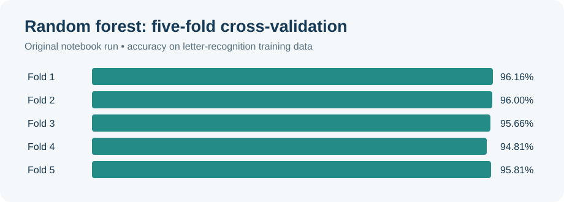

# Letter Recognition with Ensemble Learning

**Python · scikit-learn · Multiclass classification · Model evaluation**

This course assignment explores how machine-learning models can recognize the 26 capital letters of the English alphabet from numeric features extracted from character images. It compares classifiers and experiments with ensemble methods.

**Original analysis:** [Letter-recognition notebook](notebooks/letter_recognition_original.ipynb)

## Dataset and task

The notebook describes 20,000 character examples across 26 classes, each represented by 16 numerical features. Its initial analysis uses the first 16,000 rows for training and the final 4,000 for testing. The source CSV is not included in this repository.

## Approach

- Prepare labels and numeric features for multiclass classification.
- Evaluate random forest, multilayer perceptron, and one-vs-rest models.
- Explore voting and blending strategies.
- Examine feature importance and compare validation outputs.

## Results from the saved notebook

| Analysis | Saved result | Evaluation |
|---|---:|---|
| Random forest | **95.69% mean accuracy** | Five-fold cross-validation on the initial 16,000-row training set |
| Random-forest blending model | **95.53% accuracy** | Saved output on the later test-set workflow |

*Chart recreated from the original notebook's five saved fold scores.*

These are saved results, not an independently reproduced benchmark. They come from different stages and are not directly interchangeable. The notebook also contains an unrelated Iris example that reuses variables, a soft-voting prediction error caused by a feature mismatch, and convergence warnings. The blending workflow and preprocessing need a clean rerun before drawing strong conclusions about ensemble performance.

## Running and next steps

Open the [original notebook](notebooks/letter_recognition_original.ipynb) in Jupyter or Colab. It expects `letter-recognition.data.csv` in the working directory and uses Python, pandas, NumPy, and scikit-learn. Before reproducing results, obtain the original dataset, remove the unrelated example, isolate preprocessing within cross-validation, and resolve the ensemble error.

**Skills:** data preprocessing · multiclass classification · cross-validation · ensemble learning · feature importance
